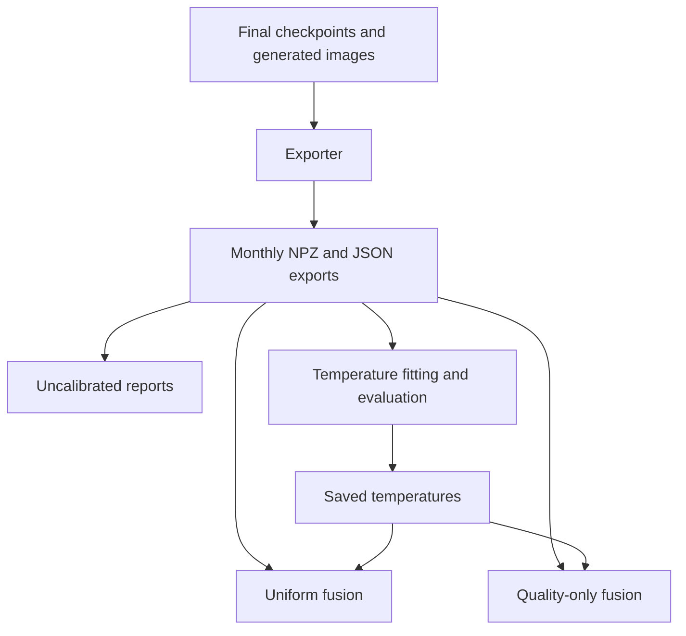

# TRAMIF: prediction export, reporting, calibration, and fusion

## 1. The purpose of the five scripts

Training has already produced a model for each view and seed. These scripts turn those trained models into reusable predictions, then evaluate and combine the predictions.

| Script | Takes | Does | Produces |
| --- | --- | --- | --- |
| `export_temporal_predictions.py` | Final checkpoints, generated images, dataset configuration, manifest, and family mapping | Runs each frozen CNN on the selected historical months | Raw logits, embeddings, labels, sample IDs, and provenance |
| `report_temporal_predictions.py` | Exported logits and labels | Evaluates each individual model at temperature `T=1` | All-51-family classification reports, confusion matrices, and summaries |
| `calibrate_temporal_predictions.py` | February and March exports | Fits a temperature using February, then evaluates that temperature on both months | One temperature per view/seed and before/after calibration metrics |
| `evaluate_uniform_fusion.py` | Exports and saved temperatures | Averages the three calibrated probability vectors within each seed | Uniform-fusion reports and comparisons against calibrated single views |
| `evaluate_quality_fusion.py` | Exports and saved temperatures | Estimates February quality, selects a common weight scale using March, and combines probabilities | Quality scores, candidate comparisons, selected weights, and quality-only reports |

Only the exporter runs the CNNs. The other four scripts calculate from saved arrays on CPU. They do not retrain a model or need to reopen the images.

## 2. Shared vocabulary and chronology

| Term | Meaning in these files |
| --- | --- |
| View | `raw_byte`, `entropy`, or `sbsmi`: three representations of the same malware sample |
| Seed | One repeated training run; defaults are `11,22,33,44,55` |
| Sample ID / `sha` | The manifest identifier used to check that rows refer to the same files across views |
| Label | The true family ID, from `0` to `50` |
| Logits | The model's 51 class scores before softmax |
| Probabilities | The 51 values after softmax; they sum to one for each sample |
| Embedding | The model's feature vector before its final linear classifier |
| Support | How many true examples a family has in the month |
| Temperature `T` | A positive scalar applied as `softmax(logits / T)` to adjust confidence |
| Quality `Q` | Negative family-balanced log loss; a larger value indicates better historical probability quality |
| Scale `a` | Controls how strongly differences in `Q` affect fusion weights |

The framework separates development from future evaluation (§§7 and 11.2):

| Period | Role in this workflow |
| --- | --- |
| August 2019–January 2020 | Final encoder training; the exporter can also run frozen inference on these months to obtain historical reference embeddings |
| February 2020 | Fit temperatures and estimate the quality scores used here |
| March 2020 | Evaluate February-fitted calibration and select the quality-only scale |
| April–September 2020 | Future test, after all relevant components have been frozen |

Both February and March exports contain **both logits and embeddings**. Their different experimental roles do not change the array types exported.

Fusion pairs the three views with the **same seed**. For example, seed 11 combines raw-byte 11, entropy 11, and SBSMI 11. Five seeds give five repeated fusion experiments. The summary mean is an average of their metrics, not a single model that averages all 15 checkpoints.

## 3. `export_temporal_predictions.py`

**Question answered:** What scores and features does each trained model produce for each selected sample?

### Inputs

| Input | Default location / role |
| --- | --- |
| Training configuration | `configs/train_temporal.yaml`; provides `dataset.root`, `dataset.manifest`, and `dataset.mapping` |
| Images and preprocessing configuration | The generated dataset root, including `config.json` and the selected months' images |
| Manifest and family mapping | Identify sample paths, months, splits, labels, and class order |
| Final checkpoint | `runs/temporal/<view>/final/seed_<seed>/final.pt` |
| Optional epoch plan | `runs/temporal/epoch_plan.json`; checked against the checkpoint if present |

The model specification comes from the checkpoint metadata. The exporter reconstructs the model through `create_branch()` in `src/training/temporal.py` and loads its weights strictly. It reuses `TemporalMultiViewDataset` and the existing image-loading contract.

### Processing

1. Restrict the requested months to the chosen historical split.
2. Check the checkpoint's view, seed, identity signature, class count, manifest, mapping, and preprocessing identifiers. If an epoch plan exists, check its selected epoch and seed membership too.
3. Load the model, disable gradients, and call `eval()`. Dropout is disabled and BatchNorm uses its stored statistics.
4. Read images in manifest order with no shuffling. Run inference using float32 input tensors and disabled autocast.
5. Check that batch IDs and labels match the manifest and that outputs have valid shapes and finite values.
6. Save the arrays and a JSON record of their origin.

The current MalSBSLCNet keeps `AdaptiveAvgPool2d((4, 4))`. Its exported embedding is the 2,048-dimensional feature after pooling, flattening, and classifier BatchNorm, before dropout and the linear classifier. The exporter uses the embedding dimension returned by the model rather than hard-coding 2,048.

### Outputs

For one view, seed, and month:

```text
runs/exports/<view>/seed_<seed>/<month>.npz
runs/exports/<view>/seed_<seed>/<month>.json
```

| NPZ key | Shape | Contents |
| --- | --- | --- |
| `sha` | `(N,)` | Ordered sample IDs |
| `labels` | `(N,)` | True class IDs |
| `month` | `(N,)` | Month associated with each row |
| `logits` | `(N, 51)` | Unscaled class scores |
| `embeddings` | `(N, D)` | Feature vectors; `D=2048` for the inspected MalSBSLCNet |
| `class_names` | `(51,)` | Family names in class-ID order |

`N` is the number of samples in the selected month. The JSON records counts, embedding dimension, checkpoint and dataset identifiers, source-code hashes, inference settings, and the NPZ checksum. Keep each NPZ together with its matching JSON: downstream scripts require both.

Defaults produce `3 views × 5 seeds × 2 months = 30` NPZ/JSON pairs. Using `--split train` without `--months` selects the six training months and produces 90 pairs.

`--skip-existing` checks provenance and file integrity before skipping completed exports. An interrupted export without a completion JSON can be regenerated; mismatched settings or corrupted completed exports raise an error. Resume uses the same command and settings.

### Main functions

| Function | Responsibility |
| --- | --- |
| `select_months()` | Enforces allowed historical months |
| `load_final()` | Validates a checkpoint and loads the frozen model |
| `export_month()` | Runs one view/seed/month and saves its arrays and metadata |
| `source_hashes()` | Records the current model, loader, training-helper, and exporter source hashes |
| `write_npz_atomic()` | Writes to a temporary file before replacing the target NPZ |

## 4. `report_temporal_predictions.py`

**Question answered:** How well does each individual model classify every family in February and March, before calibration?

### Input and processing

It reads the monthly NPZ/JSON pairs under `runs/exports`. It loads IDs, labels, months, logits, and class names; it does not load embeddings.

`load_export()` checks checksums, identity fields, the 51-class mapping, sample counts, and label validity. The main routine requires matching sample IDs, labels, row order, and class order across the selected views and seeds. Misaligned arrays raise an error; the script does not silently reorder them.

`classification_statistics()` uses `argmax(logits)` for class predictions and stable softmax for probability metrics. It calculates all family rows, a confusion matrix, and aggregate metrics.

### Outputs

Each default view/seed/month gets a folder:

```text
runs/reports/<view>/seed_<seed>/<month>/
```

| File | Contents |
| --- | --- |
| `classification_report.txt` | Readable table of all 51 families: precision, recall, F1, support, predicted count, and status |
| `classification_report.csv` | Family-level values, including TP, FP, and FN |
| `confusion_matrix.csv` | A 51 × 51 matrix; rows are true families and columns are predicted families |
| `report.json` | Detailed metrics, family support, ECE bins, definitions, and provenance |

At `runs/reports/`, `monthly_summary.csv` contains 30 view/seed/month rows by default, and `seed_summary.csv` contains six view/month groups with across-seed means and sample standard deviations.

Metrics include accuracy, supported-family macro F1, fixed-51 macro F1, weighted F1, supported-family balanced accuracy, ordinary sample-mean NLL, multiclass Brier score, and ECE with 15 equal-width confidence bins.

All 51 families remain visible even when some have no samples. Undefined per-family values use `-` in text, blank cells in CSV, and `null` in JSON. Aggregate ratios use zero for undefined values. Supported-family macro F1 averages only families with true support; fixed-51 macro F1 averages all 51. Predictions into absent families still count as errors for the actual true families. This implements the monthly-support distinction in framework §11.4.

### Relationship to later scripts

This script is also the shared reporting module. Calibration and fusion reuse `load_export()`, `classification_statistics()`, formatting, summary, hashing, and file-writing helpers.

The **Python module must exist**, but its generated report files are not inputs to calibration or fusion. Those scripts read the original exports and compute their own metrics.

## 5. `calibrate_temporal_predictions.py`

**Question answered:** Can we adjust each model's confidence using February, and how does that fixed adjustment behave on March?

### Input and processing

For every selected view/seed, the script requires **both** February and March NPZ/JSON pairs. It checks that the two months come from the same checkpoint and dataset and have disjoint sample IDs.

1. Pass only February logits and labels to `fit_temperature()`.
2. Fit one scalar `T` in the fixed interval `[0.05, 20]`, minimizing ordinary sample-mean NLL. The implementation uses derivative bisection in inverse temperature, `1/T`, with float64 calculations.
3. Retain `T=1` if no meaningful fitting improvement is found, and record whether a search boundary was reached.
4. Apply `softmax(logits / T)` separately to February and March, using that same fitted temperature.
5. Compare NLL, Brier, ECE, and mean confidence before and after scaling. Verify that predicted classes and classification metrics are unchanged.

March is needed for evaluation and input checks, but its logits and labels never enter the temperature optimizer. A positive scalar preserves each single model's argmax, so its accuracy, precision, recall, F1, and confusion matrix remain unchanged.

### Outputs

| Output | Meaning |
| --- | --- |
| `runs/calibration/<view>/seed_<seed>/temperature.json` | The fitted temperature, optimization details, before/after metrics for both months, and source identifiers |
| `runs/calibration/temperature_summary.csv` | One row per fitted temperature: 15 by default |
| `runs/calibration/monthly_calibration_summary.csv` | Before/after comparison for each view/seed/month: 30 rows by default |
| `runs/calibration/seed_calibration_summary.csv` | Means and sample standard deviations for each view/month: six groups |

Original exports stay unscaled. The script saves the temperatures and metrics, not another set of calibrated NPZ arrays. Fusion later applies each saved temperature to the original logits. The existing per-family classification tables remain valid; their original NLL/Brier/ECE values remain uncalibrated and must be distinguished from the new calibration summaries.

`fit_temperature()` performs fitting; `evaluate_temperature()` evaluates before/after behavior and checks class invariance; `seed_summary()` aggregates repeated runs.

February's post-fit metrics describe the data used for temperature fitting. March measures its forward behavior. Improvement on March is something to measure, not a guarantee (§7).

## 6. `evaluate_uniform_fusion.py`

**Question answered:** Does an equal-weight mixture of the three calibrated views help?

### Input and processing

The script reads the February/March exports and each view/seed's `temperature.json`. It checks sample alignment, class order, dataset identity, and that the temperatures refer to those exact exports and checkpoints.

For each seed and sample, it computes:

```text
p_raw     = softmax(raw_byte_logits / T_raw)
p_entropy = softmax(entropy_logits / T_entropy)
p_sbsmi   = softmax(sbsmi_logits / T_sbsmi)
p_uniform = (p_raw + p_entropy + p_sbsmi) / 3
prediction = argmax(p_uniform)
```

This is an arithmetic mean of **probabilities**. It does not average raw logits or take a majority vote. The implementation works in log space for numerical stability, while computing the same probability mixture.

No fusion weight is fitted: each view receives `1/3`. Temperatures stay fixed at their February-fitted values. Unlike scalar calibration of one model, combining models can change predicted classes and classification metrics.

### Outputs

Ten fusion-report folders are created by default:

```text
runs/fusion/uniform_calibrated/seed_<seed>/<month>/
```

Each contains `classification_report.txt`, `classification_report.csv`, `confusion_matrix.csv`, `report.json`, and `predictions.csv`.

`predictions.csv` records sample ID, true and predicted class IDs, confidence, probability assigned to the true class, per-sample NLL, and Brier score. It does not store all 51 probabilities.

At `runs/fusion/uniform_calibrated/`:

| File | Default coverage |
| --- | --- |
| `monthly_summary.csv` | 40 rows: three calibrated single views plus uniform fusion, across five seeds and two months |
| `seed_summary.csv` | Eight method/month groups with means and sample standard deviations |

The three single-view comparisons are recalculated from the exports and checked against the saved calibration metrics. The script writes full family reports for the fused method; the comparison CSVs include the individual views.

### Main functions

| Function | Responsibility |
| --- | --- |
| `checked_temperature()` | Verifies that a temperature belongs to the requested model and exports |
| `calibrated_log_probabilities()` | Converts raw logits and `T` into normalized log probabilities |
| `uniform_log_probabilities()` | Computes the equal probability mixture |
| `prediction_csv()` | Builds the per-sample prediction table |
| `write_fusion_report()` | Writes the fused classification reports |

## 7. `evaluate_quality_fusion.py`

**Question answered:** Does weighting views by February probability quality help beyond uniform fusion?

This is the quality-only baseline in framework §§6.2, 7, and 13. In the full score `r = a*Q - b*D_tilde - c*U`, where `D_tilde` is standardized drift, it implements the case `b=0` and `c=0`.

### Input and processing

It reads the same exports and temperature files as uniform fusion. It imports helpers from both `report_temporal_predictions.py` and `evaluate_uniform_fusion.py`.

1. Calculate calibrated February probabilities for each view/seed.
2. Calculate each sample's log loss: `-log(probability assigned to its true family)`.
3. Average those losses within each represented family, then average the family means equally. Negate that result to obtain `Q`.
4. For each candidate `a` in `[0, 0.5, 1, 2, 4]`, calculate `weights = softmax(a * Q)` across the three views.
5. Use each candidate weight vector to mix the three calibrated probability vectors, and evaluate both months.
6. Select one common `a` by the highest mean March supported-family macro F1 across the requested seeds. Ties within `1e-12` prefer the smaller scale.
7. Save every candidate's scores and the selected method's reports.

Each sample has equal weight when fitting a temperature. Each **represented family** has equal weight when estimating `Q`. Therefore, negating the ordinary NLL column in a summary is not a substitute for calculating `Q`.

Families absent from February are excluded from the quality average and marked unavailable in the family-quality table. They remain among the 51 output classes. Higher `Q` means lower family-balanced loss; because `Q` is negative loss, a less negative value is better.

At `a=0`, all weights equal `1/3`, reproducing uniform fusion. Larger `a` increases preference for the views with better `Q`. There is one shared selected scale, but **one three-view weight vector per seed**, because each seed has its own quality estimates. Weights are global across samples and families and stay the same for the two evaluated months.

### Outputs

The output root is `runs/fusion/quality_only/`.

| File | Contents |
| --- | --- |
| `quality_scores.csv` | February family-balanced NLL, `Q`, and temperature for every view/seed |
| `quality_by_family.csv` | All 51 family rows for every view/seed, with February support and mean loss where available |
| `candidate_weights.csv` | Three-view weights for every seed and candidate scale |
| `candidate_metrics.csv` | Every candidate's metrics for both months and every seed |
| `candidate_summary.csv` | Candidate/month means and sample standard deviations across seeds |
| `selection.json` | Grid, criterion, selected scale, all candidate March scores, quality scores, selected weights per seed, and provenance |
| `monthly_summary.csv` | 50 default rows comparing three calibrated single views, uniform fusion, and selected quality-only fusion |
| `seed_summary.csv` | Ten method/month groups with means and sample standard deviations |

The selected quality-only method also receives ten full report folders under `seed_<seed>/<month>/`, containing the same five report files as uniform fusion, including `predictions.csv`.

`quality_score()` estimates `Q`; `quality_log_weights()` converts `aQ` into weights; `weighted_log_probabilities()` mixes the predictions; `select_scale()` makes the shared March selection.

Both months are development data here: February supplies temperatures and quality scores, and March selects the scale. The selected March result is not an untouched future-test result. The script keeps February's quality scores and temperatures; it does not refit them on February plus March after selection (§7).

## 8. How the files depend on one another



The diagram shows file dependencies. There are also Python-module dependencies:

| Consumer | Required code modules | Required generated files |
| --- | --- | --- |
| Exporter | Existing dataset, data-contract, model, and training factory modules | Dataset files and final checkpoints; epoch plan when present |
| Reporter | Its own helpers | Export NPZ/JSON pairs |
| Calibration | Reporter module | Export NPZ/JSON pairs |
| Uniform fusion | Reporter module | Export NPZ/JSON pairs and temperature JSONs |
| Quality-only fusion | Reporter and uniform-fusion modules | Export NPZ/JSON pairs and temperature JSONs |

Running the reporter is useful for review, but calibration does not consume `runs/reports`. Similarly, quality-only fusion needs the uniform-fusion **module**, but not the contents of `runs/fusion/uniform_calibrated`: it recalculates uniform predictions at `a=0`.

Importing these scripts does not run their command-line workflows because each protects `main()` with `if __name__ == "__main__"`.

## 9. Commands and where to run them

Place all five Python files in the repository's `scripts` directory. Open PowerShell at the **repository root**, where `scripts`, `src`, and `configs` are visible, and activate the existing training environment.

Run these in order when creating the full February/March workflow:

```powershell
python -m scripts.export_temporal_predictions --months 2020-02 2020-03 --device cuda --skip-existing
python -m scripts.report_temporal_predictions
python -m scripts.calibrate_temporal_predictions
python -m scripts.evaluate_uniform_fusion
python -m scripts.evaluate_quality_fusion
```

Wait for each command to complete successfully. Completed stages do not need to be rerun just to proceed to the next stage. Only export uses the GPU here; the other commands use NumPy on CPU.

The separate historical-reference export is:

```powershell
python -m scripts.export_temporal_predictions --split train --device cuda --skip-existing
```

This runs the existing frozen checkpoints over August–January images. The flag selects data for inference; it does not start training. These additional embeddings prepare inputs for later drift calculations under framework §§5.2–5.4. None of the five scripts calculates MMD, bootstrap uncertainty `U`, or full reliability weights yet. Training-period predictions are also not held-out estimates of prediction quality.

The exporter currently accepts only historical train/validation splits. The other four scripts evaluate February/March only. They do not yet implement the April–September frozen-test workflow.

Useful operational details:

- Paths are relative to the repository root unless an absolute path is supplied.
- `--views` and `--months`, where supported, take space-separated values. `--seeds` takes one comma-separated value, such as `--seeds 11,22,33,44,55`.
- Summary CSVs describe the selections in the current invocation; they are rewritten rather than appended. Use a separate output root for a partial diagnostic run if you want to preserve a complete summary.
- Provenance checks can reject outputs created with different inputs, settings, or code. Keep distinct development versions in distinct output roots instead of mixing their files.
- Across-seed standard deviations describe variability among repeated fits. They are not confidence intervals or bootstrap uncertainty estimates (§11.4).

## 10. Suggested Git commit message

Use the following when adding the five scripts and this documentation:

```text
feat(evaluation): add temporal export, calibration and fusion baselines

Export historical logits and embeddings from frozen final checkpoints,
then evaluate all 51 families for February and March.

- Add monthly classification reports, confusion matrices and seed summaries
- Fit per-view, per-seed temperatures on February and evaluate both months
- Add calibrated uniform probability fusion within each seed
- Add family-balanced quality scores and shared scale selection on March
- Validate sample alignment, class order and source provenance
- Document script inputs, outputs, dependencies and command order

Keep March scale-selection results labelled as development results.
Leave April-September evaluation outside these historical scripts.
```

This is a suggested commit message; preparing this document does not create a Git commit. It describes implemented capabilities, not a claim of improved future-test performance.

## Source basis

This walkthrough was checked against `export_temporal_predictions.py`, `report_temporal_predictions.py`, `calibrate_temporal_predictions.py`, `evaluate_uniform_fusion.py`, and `evaluate_quality_fusion.py`, plus the inspected dataset loader, model, and model-construction helper. The five supplied scripts matched their local repository-copy counterparts when reviewed.

Protocol references refer to the supplied *Temporal_Reliability_Malware_Research_Framework.docx*: §§5.2–5.4 for embedding drift, §6.2 for quality/uncertainty, §7 for calibration and frozen fusion, §11.2 for chronology, §11.4 for reporting, and §13 for ablations. No training, calibration, or fusion experiment was rerun to write this guide.

